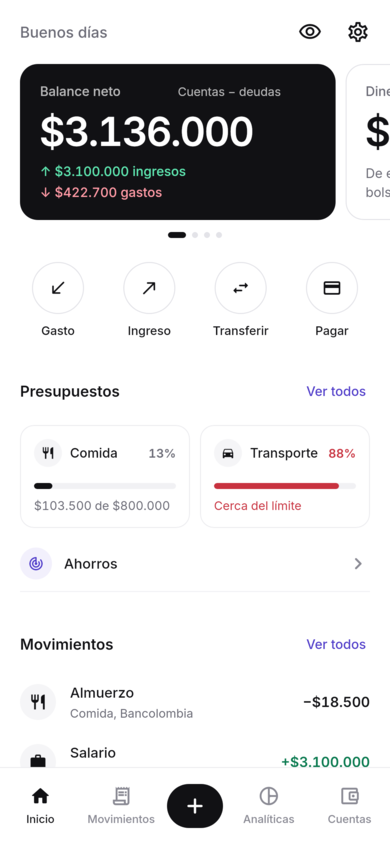
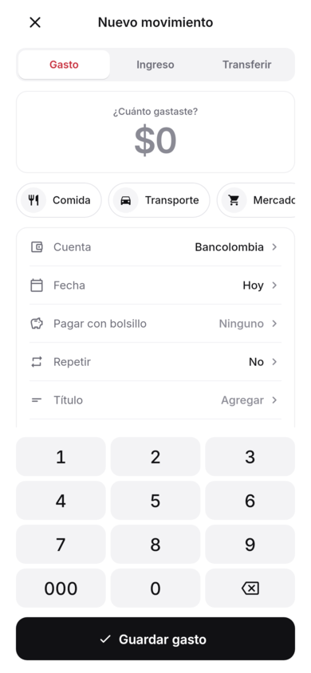
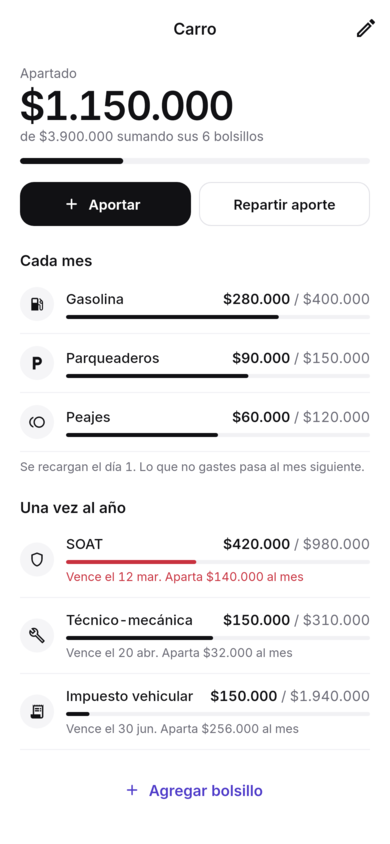
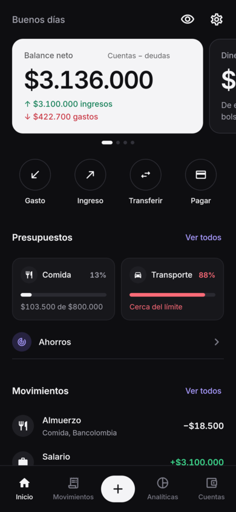
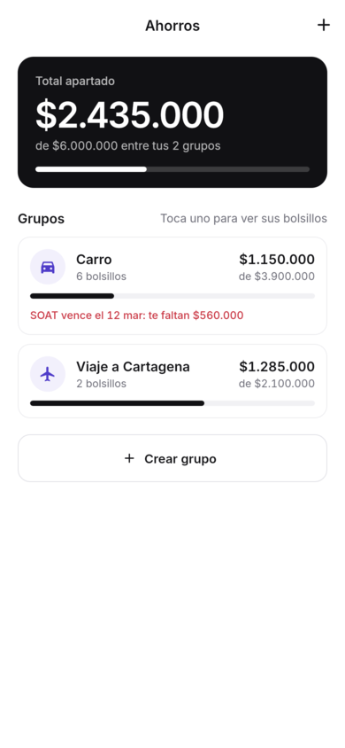
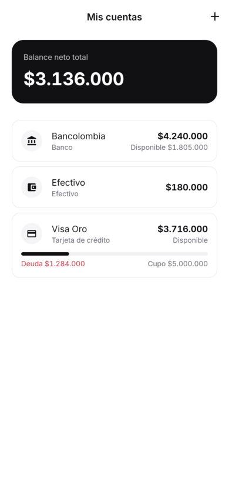

<div align="center">


# Numo

**Finanzas personales simples, privadas y sin conexión.**

[](https://github.com/agr-23/numo/actions/workflows/ci.yml)
[](LICENSE)






</div>

Numo registra tus gastos en segundos y te muestra a dónde se va el dinero.
Todo se guarda en el teléfono: no hay cuentas, servidores ni conexión con tu
banco.

*English: Numo is an offline-first personal finance app for Android, built
with Flutter. It's available in Spanish and English.*

## Funciones

- **Movimientos en segundos.** Teclado propio, categorías, transferencias
  entre cuentas y movimientos recurrentes, con opción de deshacer.
- **Cuentas y tarjetas de crédito.** Efectivo, bancos y tarjetas con cupo,
  deuda, fecha de corte y fecha límite de pago. Avisa si un gasto supera el
  cupo.
- **Presupuestos** por categoría, con alertas al 80 % y al 100 %.
- **Ahorros por grupos y bolsillos.** Por ejemplo, un grupo *Carro* con
  bolsillos mensuales (gasolina, peajes) y anuales (SOAT, impuesto). El dinero
  se aparta de una cuenta real, la app sugiere cuánto apartar cada mes para
  llegar a tiempo y un gasto puede pagarse desde un bolsillo.
- **Análisis**: gasto por categoría y evolución de ingresos y gastos.
- **Privacidad**: PIN, huella y opción de ocultar los montos. Los datos se
  exportan a CSV.
- **Español e inglés**, 10 monedas latinoamericanas y globales, modo claro y
  oscuro.

<div align="center">



</div>

## Tecnología

| | |
|---|---|
| Interfaz | Flutter 3.47 · Material 3 · tipografía Inter (incluida) |
| Estado | Riverpod 2 |
| Datos | Isar 3 (base de datos local) |
| Navegación | go_router |
| Idiomas | gen-l10n (archivos ARB en `lib/l10n`) |
| Gráficos | fl_chart |

### Arquitectura

```
lib/
  core/          tema (NumoPalette), constantes, formateadores, router, l10n
  data/
    models/      colecciones de Isar
    repositories/  lectura y escritura; los saldos se ajustan en la misma transacción
    services/    base de datos, recurrencias, exportación
  providers/     Riverpod: streams de Isar → cálculos derivados
  presentation/  pantallas por función y widgets compartidos
```

El flujo es reactivo: `Isar.watch()` → `StreamProvider` → providers derivados
(resúmenes, presupuestos, bolsillos) → interfaz. Los cálculos delicados
(montos, fechas de tarjeta, bolsillos) están en funciones puras con pruebas.

## Compilar

Requisitos: Flutter 3.47 (canal estable) y Java 17.

```bash
flutter pub get
flutter run                     # en un emulador o teléfono conectado
flutter build apk --release --split-per-abi --target-platform android-arm64
```

Después de cambiar un modelo de Isar o los textos:

```bash
dart run build_runner build --delete-conflicting-outputs   # modelos
flutter gen-l10n                                           # traducciones
```

## Calidad

```bash
flutter analyze --fatal-infos    # linter estricto (analysis_options.yaml)
dart format .                    # formato
flutter test                     # pruebas
```

La [CI](.github/workflows/ci.yml) ejecuta todo esto en cada push y pull
request, comprueba que el código generado esté al día y compila un APK de
prueba.

**Capturas sin emulador.** Las pantallas se pueden renderizar con datos de
ejemplo:

```bash
flutter test tool/screenshots/screens_test.dart --update-goldens
# → tool/screenshots/out/*.png
```

## Contribuir

Los commits siguen [Conventional Commits](https://www.conventionalcommits.org/es/).
Lee [CONTRIBUTING.md](CONTRIBUTING.md) y activa el hook que valida los
mensajes:

```bash
git config core.hooksPath tool/hooks
```

Para publicar versiones, ver [docs/RELEASING.md](docs/RELEASING.md).

## Marca

Ícono, colores y reglas de uso en [docs/brand](docs/brand/README.md).

## Licencia

[MIT](LICENSE) © 2026 Alejandro Garcés Ramírez. La tipografía Inter se
distribuye bajo la [SIL Open Font License](assets/fonts/Inter-OFL.txt).
